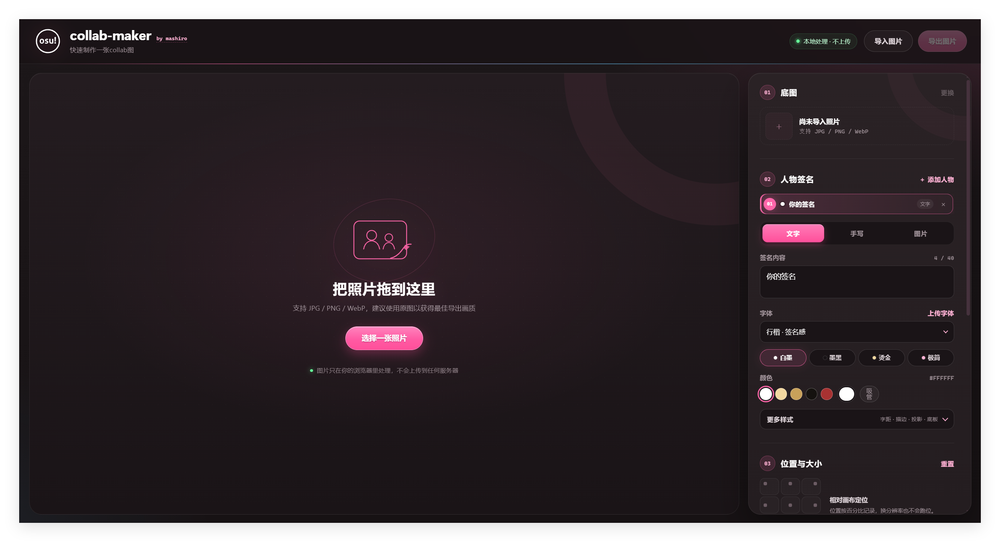

# collab-maker

给合影里的**每个人**加上一份属于自己的签名：文字、手写、图片签名都可以，每个人的位置、大小、角度、颜色、描边、投影独立调整，最后合成一张高清图片。

整个工具是一个**纯本地网页**：照片只在浏览器内存里处理，不会上传到任何服务器，也不需要安装或联网。

## 直接使用

- **双击 `index.html`**，用 Chrome / Edge 打开即可。
- Windows 也可以双击 **`启动.cmd`**。

不需要 Node.js、不需要构建、不需要起服务。

## 多人签名怎么用

1. 导入合影。
2. 给第一个人输入名字、选字体和样式。
3. 点「**＋ 添加人物**」，输入下一个人的名字。
   - 新签名会自动沿用当前文字签名的字体、颜色、描边、大小等样式，位置会错开，方便你继续调整。
   - 每个签名都是独立对象：切换类型、改颜色、拖位置，只影响当前选中的那个人。
4. 在照片上把签名拖到对应人物旁边；也可以点九宫格或调 X / Y 百分比。
5. 依次添加完所有人，点「导出图片」。

签名列表会显示每个人的名字、颜色和类型。点击列表行或直接点照片上的签名，就能切换当前编辑对象。最多支持 12 个签名。

## 功能

### 1. 底图
- 点击、拖拽或 `Ctrl+V` 粘贴照片。
- 支持 JPG / PNG / WebP（以及浏览器能解码的其他常见格式）。
- 自动处理手机照片的 EXIF 方向。
- 照片尺寸、文件大小实时显示。

### 2. 文字签名
- 任意内容，支持换行（最多 6 行）。
- 内置行楷、楷体、隶书、黑体、宋体、幼圆、英文手写等字体栈，自动回退。
- 支持上传自己的 `.ttf` / `.otf` / `.woff` 字体。
- 颜色、字距、粗体、斜体。
- 描边：颜色 + 粗细，复杂背景上也能看清。
- 投影：柔和暗影。
- 底板：半透明色块 + 圆角，适合放在浅色衣服或天空上。
- 四种一键风格：白墨、墨黑、烫金、极简。

### 3. 手写签名
- 在触控板、鼠标或触摸屏上直接写。
- 支持笔色、笔触粗细、撤销一笔、全部清空。
- 自动以透明背景叠加到照片，带轻微投影。

### 4. 图片签名
- 上传透明 PNG 或白底扫描件。
- 「去除白色背景」可把白纸签名变成透明背景，强度可调。
- 自动裁掉四周空白，签名更贴合。
- 检测到本身就是透明底的签名时，会智能关闭去白底，避免把签名“洗掉”。

### 5. 每个人的位置与大小
- 在照片上直接**拖动**当前签名。
- 拖动四角圆点等比缩放。
- 拖动顶部圆点旋转（按住 `Shift` 吸附 15°）。
- 九宫格快速定位到四角 / 边中 / 居中。
- 水平 X、垂直 Y 按**百分比**记录，换分辨率导出也不会跑位。
- 大小按画面高度百分比记录；另有旋转、不透明度滑杆。
- 其他签名会显示淡淡的虚线框和编号，和左侧列表一一对应。

### 6. 导出
- 所有签名一起合成，不包含编辑框和编号。
- PNG / JPG / WebP。
- 原始尺寸、2×、3× 三种倍率。
- JPG / WebP 可调画质（50–100）。
- 自定义文件名。
- 自动阻止会超出浏览器画布上限的超大导出。

## 快捷键

| 操作 | 快捷键 |
| --- | --- |
| 微调位置 | 方向键（`Shift` + 方向键 加速） |
| 旋转 ±1° | `[` / `]` |
| 缩放签名 | 鼠标滚轮悬停在签名上 |
| 旋转吸附 | 拖动旋转手柄时按住 `Shift` |
| 粘贴照片 | `Ctrl+V` |
| 导出 | `Ctrl+S` |
| 退出取色 | `Esc` |
| 查看原图 | 按住「按住查看原图」 |
| 切换签名 | 点击照片上的签名，或点击左侧列表 |

## 隐私

- 所有图片解码、签名合成、导出都在本机浏览器内完成。
- 没有后端、没有埋点、没有网络请求。
- **关闭页面后，当前编辑内容不会保留**；需要的话请先导出图片。

## 浏览器建议

- Chrome / Edge 100+、Safari 16+、Firefox 110+。
- 建议使用最新版 Chromium 内核浏览器，字体渲染和 WebP 导出最稳定。
- 超大照片（超过约 6000 万像素）导出时可能受浏览器内存限制，工具会提前提示。

## 小贴士

- **多人风格统一**：调好第一个人的样式后再点「添加人物」，后面的签名会沿用同一套字体、颜色和描边。
- **每个人单独调整**：切换列表里的某一行，再改颜色、旋转、大小，不会影响其他人。
- **白底签名**：上传后勾选「去除白色背景」，强度从 55 开始微调。
- **浅色照片**：用「墨黑」或「极简」预设；深色照片用「白墨」「烫金」。
- **自然的位置**：把签名放在人物肩膀下方、脚边或画面留白处，大小控制在画面高度的 5%–10% 通常最自然。

## 说明

工具不收集、不上传任何用户照片。
